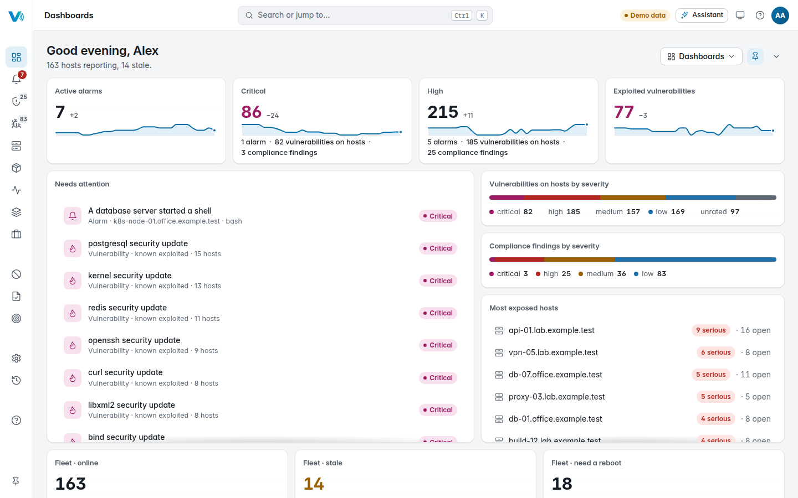

<p align="center">
  <picture>
    <source media="(prefers-color-scheme: dark)" srcset="docs/brand/openvibes-wordmark-dark.svg">
    
  </picture>
</p>

<h3 align="center">OpenVIBES Platform</h3>

<p align="center">
  The server side of <a href="https://github.com/openvibes-project">OpenVIBES</a>, a free, self-hosted security tool
  for homelabs and small businesses. It collects what the agents find on your
  hosts and shows you what to fix first.
</p>

<p align="center">
  <a href="https://openvibes-project.github.io/openvibes-platform/">Live demo</a> ·
  <a href="docs/quick-setup.md">Install</a> ·
  <a href="docs/capabilities.md">What it does in detail</a>
</p>

<p align="center">
  <picture>
    <source media="(prefers-color-scheme: dark)" srcset="docs/images/console-dashboard-dark.png">
    
  </picture>
</p>

## What it does

- **Enrolls agents** over mutual TLS with its own certificate authority,
  and hands them signed rules.
- **Finds vulnerabilities:** matches every host's packages against security
  advisories and ranks what to patch first, using known-exploited and
  exploit-likelihood data.
- **Checks hardening and compliance** per host group, and raises **threat
  alarms** from what runs on your hosts.
- **One web console** for hosts, alarms, vulnerabilities, compliance,
  software, ports, services and cases, with roles, host groups and single
  sign-on.
- **An optional AI assistant** that runs on the platform itself; nothing
  leaves your network.
- **Works without internet:** an offline installer, and vulnerability data
  from a mirror or a file.

## Install

The platform runs on **Fedora 44**, x86_64 (2 GB of RAM served 500
simulated hosts in the lab). On the server:

```sh
sudo sh -c "$(curl -fsSL https://openvibes-project.github.io/install.sh)"
```

The admin menu then walks you through the install. Step by step, including the first
agent: [`docs/quick-setup.md`](docs/quick-setup.md). Without internet, use
the offline kit from the [latest release](https://github.com/openvibes-project/openvibes-platform/releases/latest).

Agents run on Fedora, AlmaLinux, Rocky Linux, Debian, Ubuntu and Arch, and
on Windows as a preview. You add them from the console's Settings ›
Enrollment.

## Build and test

```sh
git clone --recurse-submodules https://github.com/openvibes-project/openvibes-platform.git
cd openvibes-platform
eval "$(scripts/test-db.sh)"     # a throwaway PostgreSQL for the tests
cargo clippy --locked --workspace --all-targets --all-features -- -D warnings
cargo test --locked --workspace --all-features
scripts/build-rpm.sh             # RPMs in target/rpm/RPMS/x86_64/
```

Running the console locally with live reload: [`docs/dev-setup.md`](docs/dev-setup.md).

## Documentation

- [`docs/capabilities.md`](docs/capabilities.md): every service in detail, and what is planned.
- [`docs/components/`](docs/components/): one page per crate and service.
- [`docs/sizing.md`](docs/sizing.md), [`docs/network-destinations.md`](docs/network-destinations.md),
  [`docs/dependencies.md`](docs/dependencies.md): requirements, firewall addresses, licences.
- [`docs/specs/`](docs/specs/): the designs.

## Contributing

Issues and pull requests are welcome; see [`CONTRIBUTING.md`](CONTRIBUTING.md).
Security problems: please use private vulnerability reporting, not a public
issue.

**AI disclosure:** OpenVIBES is built with the help of AI coding tools
(Claude Code and Codex). Every change goes through a pull request and the
full CI before it is merged.

Licensed under the [Apache License 2.0](LICENSE).
